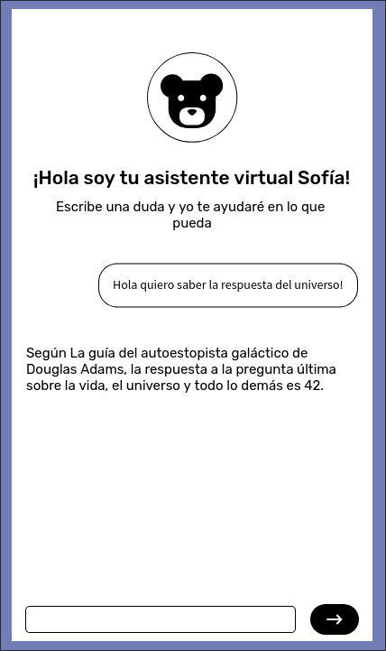
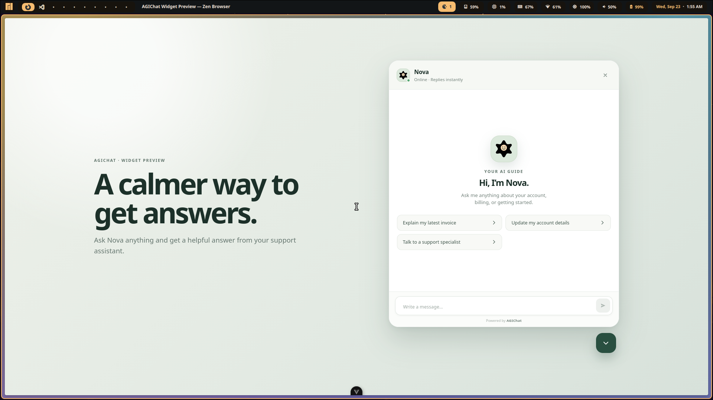
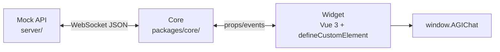

# AGIChat

AGIChat es un SDK de widget de chat embebible para clientes de la startup AGIChat.
La primera fase del proyecto busca construir una experiencia visual alineada al wireframe
de referencia, con una arquitectura preparada para sustituir el mock por un agente real
sin rehacer la interfaz.

## Contexto

La propuesta inicial del proyecto es resolver estos puntos:

- Crear un widget de chat que pueda incrustarse fácilmente en productos de terceros.
- Separar el backend simulado, la lógica de chat y la UI para permitir trabajo paralelo.
- Mantener el contrato de mensajes estable para no romper el cambio entre mock API y agente real.
- Renderizar respuestas en Markdown de forma segura desde la UI.
- Soportar un flujo de desarrollo con GitHub Flow, PRs, CI/CD y cobertura mínima del 80%.

## Wireframe

La interfaz base del widget debe seguir el wireframe entregado por la propuesta inicial.
La imagen de referencia está versionada dentro del repo para que el equipo la tenga a mano:



La paleta, tipografía y estilo visual pueden cambiar, pero los flujos y estados de UX deben
respetar esta referencia salvo que el equipo acuerde una modificación explícita.

## Interfaz final implementada

A continuación se muestra el resultado final del widget integrado y su entorno de demostración:



### Características clave de la interfaz:
- **Diseño responsive adaptable**: En pantallas de escritorio y monitores amplios aprovecha el espacio horizontal mediante una distribución en dos columnas (hero/introducción a la izquierda y panel de chat a la derecha), adaptándose automáticamente a una columna fluida en tablets y móviles.
- **Experiencia de usuario y estados del wireframe**:
  - **Estado inicial**: Pantalla de bienvenida con avatar y sugerencias clicables (*quick replies*).
  - **Conversación en tiempo real**: Mensajes diferenciados para usuario y agente con marcas de tiempo en la hora local del sistema.
  - **Feedback de respuesta**: Indicador animado de tipeo (*typing indicator*) y deshabilitación preventiva del compositor mientras el agente responde.
  - **Manejo de errores**: Tarjeta de alerta informativa con botón de reintento (*Try again*) ante fallos de conexión.
- **Renderizado seguro de Markdown**: Las respuestas del agente se formatean con Markdown enriquecido y saneado estricto contra vulnerabilidades XSS (vía DOMPurify).
- **Acceso flotante (*Launcher*)**: Botón inferior para abrir y minimizar el widget con animaciones fluidas preservando el historial en memoria durante la sesión.

## Arquitectura



- `server/` contiene el mock API con Elysia + Bun y valida el contrato WebSocket.
- `packages/core/` contiene el composable `useChat`, el estado de dominio y el transporte.
- `widget/` contiene la UI Vue 3, el montaje como Custom Element y la API pública `window.AGIChat`.

## Estructura del monorepo

```text
server/
  src/
    schemas/        # TypeBox y tipos del protocolo WebSocket
    handlers/       # lógica del mock API
packages/
  core/
    src/
      composables/  # useChat y conexión WebSocket
      types/        # estado y tipos del dominio
      services/     # adaptadores de transporte, si hacen falta
widget/
  src/
    components/     # componentes visuales del widget
      utils/          # renderizado y sanitización de Markdown
    styles/         # estilos del widget
docs/               # notas de arquitectura y decisiones
  images/           # recursos visuales de referencia, como el wireframe
```

## Documentación y contratos

- [`docs/architecture.md`](./docs/architecture.md) contiene la justificación arquitectónica completa, diagramas en Mermaid.js y la guía para nuevos desarrolladores sobre cómo escalar el proyecto.
- [`CONTRACTS.md`](./CONTRACTS.md) define el contrato entre Mock API, Core y UI.
- [`AGENTS.md`](./AGENTS.md) define reglas de colaboración, estructura y límites por capa.

## Comandos

Desde la raíz del repositorio:

```bash
bun install
bun run lint
bun run typecheck
bun run test:coverage
bun run build
```

La CI aplica un gate mínimo de 80% para líneas, funciones, ramas y sentencias a partir
de los reportes LCOV de Bun y Vitest. El reporte de Vitest incluye componentes `.vue`.
Los helpers compartidos de pruebas viven en `test/helpers/`.

## Docker Compose

El stack completo se puede levantar desde la raíz con:

```bash
cp .env.example .env
docker compose config
docker compose up --build
```

El widget queda disponible en `http://localhost:4173` y el servidor en
`http://localhost:3000`. Los servicios `tmdb-mcp` y `books-mcp` escuchan internamente
en los puertos `3101` y `3102`; no se publican directamente al host. El servidor los
alcanza mediante los nombres DNS de Compose (`tmdb-mcp` y `books-mcp`).

Por defecto, `AGENT_MODE=mock`, por lo que el stack arranca sin claves de proveedor.
Para activar el modo real, configura `AGENT_MODE=groq`, `GROQ_API_KEY`, `GROQ_MODEL`,
las credenciales de TMDB y, si aplica, `GOOGLE_BOOKS_API_KEY` en el `.env` local.
Las variables de URLs MCP se fijan dentro de Compose para usar la red interna; no
deben apuntar a `localhost` desde el contenedor del servidor.

Todos los servicios tienen healthcheck. El servidor espera a que ambos MCP estén
saludables y el widget espera a que el servidor responda antes de iniciar.

Comandos útiles por paquete:

```bash
bun --cwd server dev
bun --cwd widget dev
bun --cwd widget test:unit
```

## Modo real

Por defecto `AGENT_MODE=mock`. Para ejecutar el agente real con Groq, TMDB y Google Books:

1. Configura en `.env` (sin commitear):
   - `AGENT_MODE=groq`
   - `GROQ_API_KEY`, `GROQ_MODEL`, `TMDB_API_READ_ACCESS_TOKEN`, `TMDB_API_KEY` y `GOOGLE_BOOKS_API_KEY`
2. Con Docker Compose:
   ```bash
   docker compose up --build
   ```
3. En desarrollo local (sin Docker), asegúrate de tener `TMDB_MCP_URL=http://localhost:3101/mcp` y `BOOKS_MCP_URL=http://localhost:3102/mcp` en `.env`, y ejecuta en terminales separadas:
   ```bash
   bun run dev:tmdb-mcp
   bun run dev:books-mcp
   bun run dev:server
   bun run dev:widget
   ```
El servidor imprime `Agente: groq` (o `Agente: mock`) al iniciar.

## Notas

- El frontend actual está implementado en `widget/` como base del SDK público.
- `packages/core/` es la capa compartida donde debe vivir la lógica del chat.
- El objetivo de esta fase es tener el widget listo para conectar un agente real sin cambiar el contrato.
