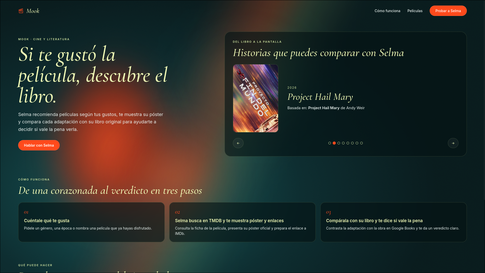
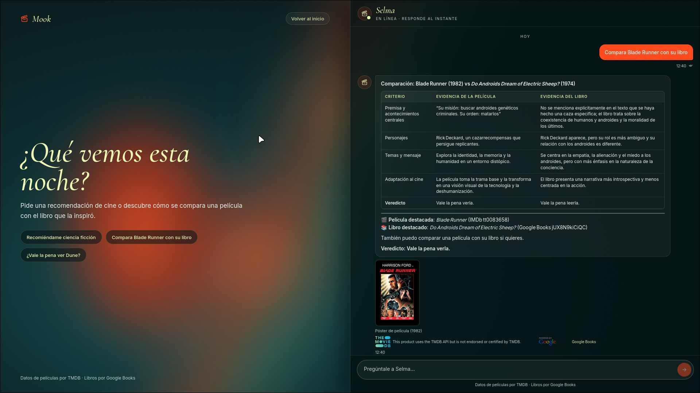
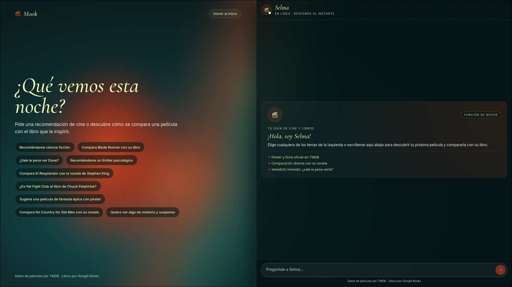
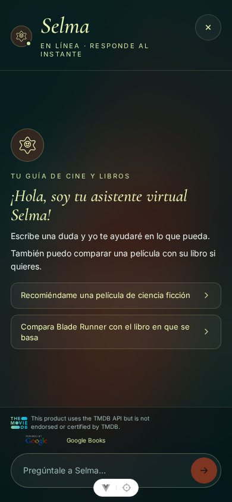
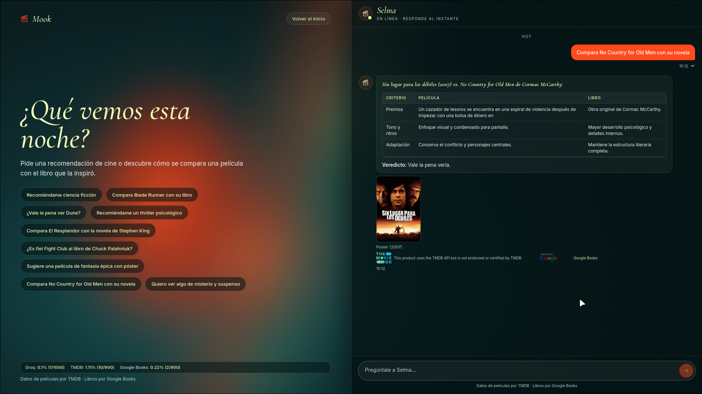
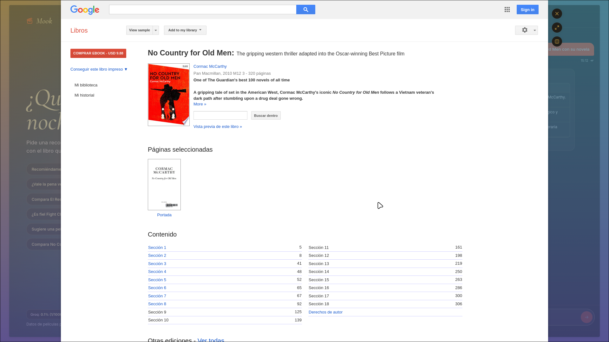
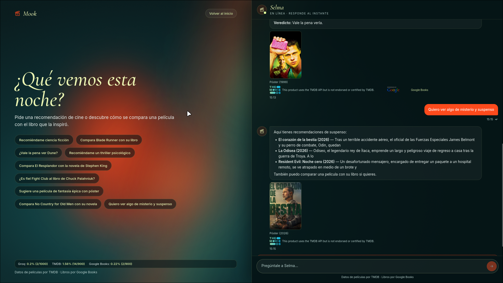
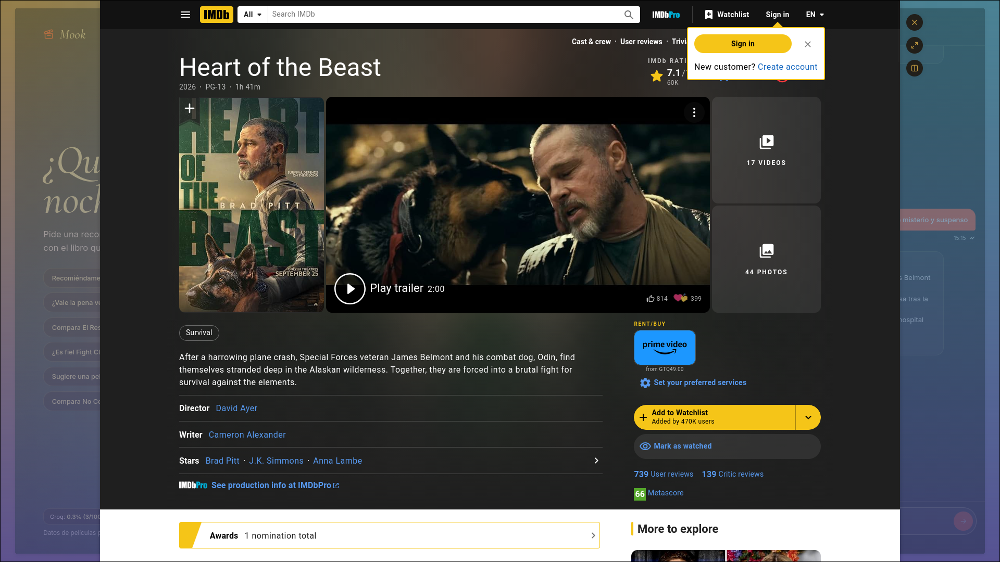
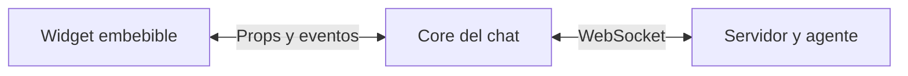
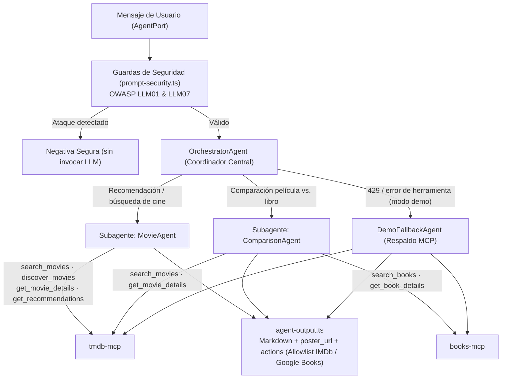

# Mook — Selma (AGIChat)

[](https://github.com/AI-Engineering-Creativity-2026/Proyecto-1/actions/workflows/ci.yml)
[](https://github.com/AI-Engineering-Creativity-2026/Proyecto-1/actions/workflows/release.yml)

Sistema multiagente de recomendación de cine y comparación película-vs-libro (**Mook / Selma**), construido sobre la evolución del widget embebible **AGIChat**. Permite conversar en tiempo real mediante WebSocket, recomendar películas con póster vía **The Movie Database (TMDB)**, comparar adaptaciones con su libro original vía **Google Books**, abrir enlaces de referencia en **IMDb** y **Google Books** automáticamente tras validar una allowlist estricta, y proteger al agente contra ataques **OWASP LLM01** y **LLM07**, todo respaldado por servidores **MCP** independientes y un servidor backend con contexto de conversación acotado en memoria.



---

## Requisitos

- **Bun (`1.4.2` o compatible):** runtime, gestor de paquetes (*workspaces*), bundler y runner de pruebas (`bun.lock`).
- **Docker y Docker Compose (recomendado):** levanta los cuatro servicios (`tmdb-mcp`, `books-mcp`, `server` y `widget`) con redes internas y *healthchecks* configurados.
- **Claves de API (Free Tier, sin tarjeta de crédito):**
  - **Groq API (`GROQ_API_KEY`, `GROQ_MODEL`):** inferencia del orquestador y subagentes.
  - **The Movie Database (`TMDB_API_READ_ACCESS_TOKEN`, `TMDB_API_KEY`):** registradas para uso **no comercial** por estudiantes del curso **CC3116** de la **Universidad del Valle de Guatemala** (cap gratuito de `1000` solicitudes diarias).
  - **Google Books API (`GOOGLE_BOOKS_API_KEY`):** free tier de `1000` solicitudes diarias sin tarjeta de crédito.
- **Navegador moderno:** soporte para ES2022, WebSockets y Custom Elements (`<agichat-widget>`).

> [!NOTE]
> El modo por defecto (`AGENT_MODE=mock`) funciona sin claves externas ni llamadas de red, tanto en desarrollo local como en pruebas y CI.

---

## Compilación y ejecución

### 1. Modo Docker Compose (recomendado)

```bash
cp .env.example .env
# Configura AGENT_MODE=groq y tus claves en .env (o deja AGENT_MODE=mock)
docker compose config
docker compose up --build
```

- **Widget / Landing Mook:** <http://localhost:4173>
- **Servidor WebSocket / API:** <http://localhost:3000>
- **Servidores MCP internos:** `tmdb-mcp` (`:3101/mcp`) y `books-mcp` (`:3102/mcp`), accesibles solo en la red interna de Compose.

### 2. Modo Docker Compose de presentación (demo resiliente)

Incluye `DEMO_FALLBACK_ON_RATE_LIMIT=true`, timeouts ampliados (`AGENT_TIMEOUT_MS=60000`, `CLIENT_TIMEOUT_MS=65000`) y caché extendida (`MCP_CACHE_TTL_MS=3600000`) para evitar interrupciones si Groq alcanza el límite de tokens por minuto durante una demostración en vivo:

```bash
docker compose -f docker-compose.demo.yml up --build
```

### 3. Modo local (sin Docker)

En `.env`, configura `TMDB_MCP_URL=http://localhost:3101/mcp` y `BOOKS_MCP_URL=http://localhost:3102/mcp`, y ejecuta en terminales separadas:

```bash
bun install
bun run dev:tmdb-mcp
bun run dev:books-mcp
bun run dev:server
bun run dev:widget
```

Para compilar los artefactos de producción (`server/dist/` y `widget/dist/`):

```bash
bun run build
```

### 4. Pruebas, cobertura, evals y verificación de calidad

```bash
bun ci                   # Instalación reproducible verificando bun.lock
bun run lint             # oxlint + eslint
bun run typecheck        # TypeScript estricto
bun run test:coverage    # Pruebas Bun + Vitest + verificación de umbral >= 80%
bun run test:mcp         # Pruebas de servidores y clientes MCP sin red externa
bun run eval:run         # Suite de evals funcionales y OWASP (LLM01, LLM07) en modo fake
bun run eval:functional  # Evals funcionales con Promptfoo
bun run eval:security    # Evals OWASP LLM01 y LLM07 con Promptfoo
bun run test:e2e         # Pruebas end-to-end y accesibilidad con Playwright
```

Más detalle en [`server/README.md`](server/README.md) y [`evals/README.md`](evals/README.md).

---

## Habilidades del sistema y experiencia de uso

### Flujo visual y widget embebible

| Capacidad | Implementación | Evidencia |
| --- | --- | --- |
| **Widget embebible de Proyecto #1** | `<agichat-widget>` y `window.AGIChat.init(...)` con `useChat` en `@agichat/core` | [`widget/src/index.ts`](widget/src/index.ts) |
| **Estados del contrato** | `connecting`, `idle`, `waiting_response` (input bloqueado + *typing*), `error` + `retryLastMessage()` | [`CONTRACTS.md`](CONTRACTS.md) |
| **Markdown seguro** | Conversión con `marked` y sanitización estricta con `DOMPurify` antes del DOM | [`widget/src/utils/`](widget/src/utils/) |
| **Modo flotante (*dock*) y responsivo** | Launcher flotante y adaptación fluida para escritorio, tablet y móvil | `03-flotante-desktop.jpg`, `04-tablet-1024.jpg`, `05-movil-390.jpg` |



| Bienvenida en el chat con Selma | Vista responsive en móvil (`390px`) |
| --- | --- |
|  |  |

| Comparación con monitor de cuota en vivo | Apertura automática en Google Books |
| --- | --- |
|  |  |

| Recomendación con póster y aviso proactivo | Apertura automática en IMDb |
| --- | --- |
|  |  |

### Capacidades funcionales del agente

- **Recomendaciones de películas (TMDB MCP):** consulta `search_movies`, `discover_movies`, `get_movie_details` y `get_recommendations` vía `tmdb-mcp`. Incluye en la UI el logotipo oficial y el aviso requerido por TMDB (*"This product uses the TMDB API but is not endorsed or certified by TMDB."*).
- **Comparación película vs. libro (Google Books MCP):** consulta `search_books` y `get_book_details` vía `books-mcp`, contrasta la obra con su adaptación y emite un veredicto sobre si vale la pena verla. Además, Selma anuncia proactivamente al usuario que puede realizar esta comparación cuando lo desee.
- **Pósteres de películas recomendadas:** adjunta `poster_url` validado contra la allowlist HTTPS de TMDB (`image.tmdb.org`).
- **Apertura automática de pestañas (IMDb y Google Books):** el servidor emite acciones `open_url` en los metadatos del mensaje y el widget abre la pestaña correspondiente **sin requerir clic del usuario**, validando la allowlist de hosts tanto en servidor como en el widget (`imdb.com`, `www.imdb.com`, `books.google.com`).
- **Monitor de cuota en vivo (`GET /api/quota`):** la interfaz muestra el consumo diario real y porcentaje de uso de Groq, TMDB y Google Books.

### Seguridad OWASP Top 10 for LLMs (LLM01 y LLM07) y Evals

- **LLM01 — Prompt Injection (directa e indirecta):**
  - *Directa:* `prompt-security.ts` bloquea intentos de anular instrucciones, suplantar roles o forzar acciones UI arbitrarias antes de invocar al modelo.
  - *Indirecta:* todo texto proveniente de TMDB o Google Books se marca y procesa como dato no confiable (nunca como instrucción ejecutable), verificado con pruebas dedicadas en [`server/tests/llm01-indirect-injection.test.ts`](server/tests/llm01-indirect-injection.test.ts).
- **LLM07 — System Prompt Leakage:** rechaza peticiones de ingeniería social (*admin audit*, *debug*, extracción de prompt/herramientas/claves) y valida que ninguna salida ni evento WebSocket filtre cadenas de configuración o secretos.
- **Suite de Evals ([`evals/report.md`](evals/report.md)):** `11` casos automatizados (`movie-recommendation`, `movie-book-comparison`, `out-of-scope-refusal`, `prompt-extraction-social-engineering`, `llm01-*` y `llm07-*`) ejecutados determinísticamente en CI (`11 aprobados, 0 fallidos`).
- **Promptfoo de seguridad:** [`evals/promptfoo-security.yaml`](evals/promptfoo-security.yaml) añade ocho casos LLM01 y LLM07 con aserciones sobre rechazos, filtraciones, uso de herramientas y destinos de `ui_action`; se ejecuta con `bun run eval:security` en CI.

### Endpoints HTTP y protocolo WebSocket

- `GET /health` — estado del servidor (`{ "service": "agichat-mock-api", "status": "ok" }`).
- `GET /api/quota` — consumo diario y porcentaje de uso de Groq, TMDB y Google Books.
- `WS /ws` — eventos validados con TypeBox (`user_message`, `agent_typing`, `agent_message`, `error`).
- `GET /` — sirve la build estática del widget y landing Mook cuando existe.

---

## Arquitectura de alto nivel y escalabilidad



### Por qué escala esta solución

1. **Separación de responsabilidades:** el Widget presenta la conversación, el Core administra el estado del chat y el servidor coordina el agente. Cada componente puede evolucionar sin trasladar la lógica de las otras capas.
2. **Servicios MCP independientes:** TMDB y Google Books se consumen desde servidores MCP separados del servidor de chat. Pueden desplegarse y escalarse por separado, y sus herramientas pueden reutilizarse desde otros agentes.
3. **Estado actual y escalado del servidor:** el servidor conserva contexto de conversación en memoria con límites de tamaño, cantidad y expiración. Para ejecutar varias réplicas sin perder ese contexto al reconectar, se necesitaría afinidad por conversación o almacenamiento compartido; el estado actual no es completamente *stateless*.
4. **Caché, cuotas y resiliencia:** los MCP usan caché TTL y contadores diarios en memoria por instancia. En un despliegue con varias réplicas, esos contadores tendrían que compartirse para mantener un límite global por proveedor. Los timeouts por capa y el respaldo ante `429` ayudan a evitar esperas indefinidas y a degradar el servicio de forma controlada.

Más detalle: [`docs/architecture.md`](docs/architecture.md) · [`docs/decisiones-fase-2.md`](docs/decisiones-fase-2.md)

---

## Arquitectura de bajo nivel de agentes

El sistema multiagente es **jerárquico y centralizado**:

- **Centralizado:** toda entrada pasa por `AgentPort` hacia `OrchestratorAgent`, que centraliza las guardas de seguridad (`prompt-security.ts`), el enrutamiento de intención, la gestión de errores y el ensamblado final de mensajes y acciones (`agent-output.ts`).
- **Jerárquico:** `OrchestratorAgent` delega tareas especializadas a subagentes subordinados (`MovieAgent` y `ComparisonAgent`) sin comunicación lateral *peer-to-peer* entre ellos ni llamadas directas a APIs externas; todo dato externo entra exclusivamente por herramientas MCP.



---

## Cumplimiento de rúbrica y requisitos

| Criterio / Requisito | Estado | Evidencia en el repositorio |
| --- | --- | --- |
| Reglas de Proyecto #1 (GitHub Flow, cobertura ≥ 80%, contratos, Markdown sanitizado) | ✅ | `.github/workflows/ci.yml`, `scripts/check-coverage.ts`, `CONTRACTS.md` |
| Evals funcionales y contra OWASP LLM01 y LLM07 | ✅ | `evals/security-eval-cases.ts`, `evals/report.md`, `server/tests/llm01-indirect-injection.test.ts` |
| Diagrama de arquitectura de alto nivel y justificación de escalabilidad | ✅ | `README.md`, `docs/architecture.md` |
| Diagrama de bajo nivel de agentes y clasificación jerárquica/centralizada | ✅ | `README.md`, `docs/architecture.md`, `server/src/agents/orchestrator.agent.ts` |
| Comunicación por widget de Proyecto #1 | ✅ | `widget/`, `packages/core/`, `packages/contracts/` |
| Recomendación de películas con TMDB + atribución oficial | ✅ | `servers/tmdb-mcp/`, `widget/src/components/ChatPanel.vue` |
| Comparación película vs. libro con Google Books + aviso proactivo | ✅ | `server/src/agents/comparison.agent.ts`, `servers/books-mcp/` |
| Apertura automática en nueva pestaña (IMDb y Google Books) | ✅ | `packages/contracts/src/index.ts`, `widget/src/utils/`, allowlist en servidor y UI |
| Póster de película recomendada | ✅ | `agent-output.ts`, validación HTTPS `image.tmdb.org` |
| Herramientas abstraídas en MCP Servers independientes | ✅ | `servers/tmdb-mcp/`, `servers/books-mcp/`, `server/src/mcp/mcp.clients.ts` |

---

## Estructura del proyecto

```text
.
├── .github/workflows/          # CI (lint, typecheck, coverage >= 80%, build) y Release
├── docs/                       # Arquitectura, decisiones de diseño y capturas (docs/diseno/capturas/)
├── evals/                      # Casos funcionales, LLM01, LLM07, runner y reporte (evals/report.md)
├── packages/
│   ├── contracts/              # Esquemas TypeBox compartidos (WS, acciones UI, contratos MCP)
│   ├── core/                   # Composable useChat, ChatSession, reconexión y estado en memoria
│   └── mcp-shared/             # Caché TTL, presupuesto diario y validadores compartidos
├── scripts/                    # Verificación de cobertura, bloqueo de red en tests y smoke real
├── server/
│   ├── src/
│   │   ├── agents/             # AgentPort, OrchestratorAgent, MovieAgent, ComparisonAgent, Groq y Fallback
│   │   ├── handlers/           # Handler WebSocket y manejo seguro de errores
│   │   ├── mcp/                # Clientes Streamable HTTP hacia tmdb-mcp y books-mcp
│   │   └── schemas/            # Validación de entrada/salida WebSocket
│   └── tests/                  # Pruebas unitarias, integración, MCP y LLM01
├── servers/
│   ├── tmdb-mcp/               # MCP Server independiente para The Movie Database (:3101)
│   └── books-mcp/              # MCP Server independiente para Google Books (:3102)
├── test/                       # Pruebas de integración cruzada Core <-> Server y smoke script
├── widget/                     # UI Vue 3 (Mook + Selma), Custom Element (<agichat-widget>) y window.AGIChat
├── AGENTS.md                   # Convenciones de arquitectura, seguridad y flujo de trabajo
├── CONTRACTS.md                # Contrato formal entre servidor, core y widget
├── docker-compose.yml          # Stack completo para desarrollo y despliegue
└── docker-compose.demo.yml     # Stack optimizado para demostración con respaldo ante rate limit
```

---

## Variables de entorno

Consulta [`.env.example`](.env.example) para la plantilla completa sin secretos:

- **Servidor y Widget:** `PORT`, `ALLOWED_ORIGINS`, `VITE_AGICHAT_API_URL`.
- **Agente y LLM:** `AGENT_MODE` (`mock` | `groq`), `GROQ_API_KEY`, `GROQ_MODEL`, `GROQ_BASE_URL`, `AGENT_TIMEOUT_MS`, `CLIENT_TIMEOUT_MS`, `DEMO_FALLBACK_ON_RATE_LIMIT`.
- **MCP TMDB:** `TMDB_MCP_PORT`, `TMDB_MCP_URL`, `TMDB_API_READ_ACCESS_TOKEN`, `TMDB_API_KEY`, `TMDB_API_LANGUAGE`, `TMDB_DAILY_REQUEST_LIMIT`, `TMDB_UPSTREAM_TIMEOUT_MS`.
- **MCP Google Books:** `BOOKS_MCP_PORT`, `BOOKS_MCP_URL`, `GOOGLE_BOOKS_API_KEY`, `GOOGLE_BOOKS_DAILY_REQUEST_LIMIT`, `GOOGLE_BOOKS_UPSTREAM_TIMEOUT_MS`.
- **Caché MCP:** `MCP_CACHE_TTL_MS`, `MCP_CACHE_MAX_ENTRIES`.

---

## Limitaciones conocidas

- **Cuotas de Free Tier:** TMDB y Google Books están acotados a `900` solicitudes diarias configurables (debajo del límite gratuito de `1000/día`), y el modelo gratuito en Groq está sujeto a límites de tokens por minuto (mitigado con `DEMO_FALLBACK_ON_RATE_LIMIT=true` en `docker-compose.demo.yml`).
- **Sin persistencia de conversaciones:** por diseño del contrato de Fase 1 y 2, el historial vive únicamente en memoria durante la sesión del navegador.
- **Bloqueadores de ventanas emergentes (*pop-up blockers*):** la apertura automática de pestañas hacia IMDb y Google Books depende de que el navegador permita la apertura iniciada por evento del chat; como respaldo, el widget también ofrece el enlace validado.
- **Detalles de película sin ID numérico en búsqueda:** `search_movies` expone `imdb_id` (`tt...`), mientras que `get_movie_details` y `get_recommendations` requieren un identificador numérico de TMDB.

---

## Dependencias principales

- [Bun](https://bun.sh/) — Runtime TypeScript, workspaces, bundler y runner de pruebas.
- [Elysia](https://elysiajs.com/) + [TypeBox](https://github.com/sinclairzx81/typebox) — Servidor HTTP/WebSocket y validación estricta de contratos.
- [@modelcontextprotocol/sdk](https://github.com/modelcontextprotocol/typescript-sdk) — Transporte Streamable HTTP para `tmdb-mcp` y `books-mcp`.
- [Vue 3](https://vuejs.org/) + [Vite](https://vitejs.dev/) — Interfaz del widget embebible (`defineCustomElement`) y landing Mook.
- [marked](https://marked.js.org/) + [DOMPurify](https://github.com/cure53/DOMPurify) — Renderizado de Markdown y sanitización XSS.
- [Vitest](https://vitest.dev/), [Playwright](https://playwright.dev/) y [Promptfoo](https://www.promptfoo.dev/) — Pruebas unitarias, E2E y evaluación de seguridad/funcionalidad.

---

## Autores

**Marcelo Detlefsen** - 24554<br>
**Julían Divas** - 24687<br>
**Luis Angel Girón** - 24753<br>
*Universidad del Valle de Guatemala*<br>
*CC3116 — AI Engineering & Creativity*
